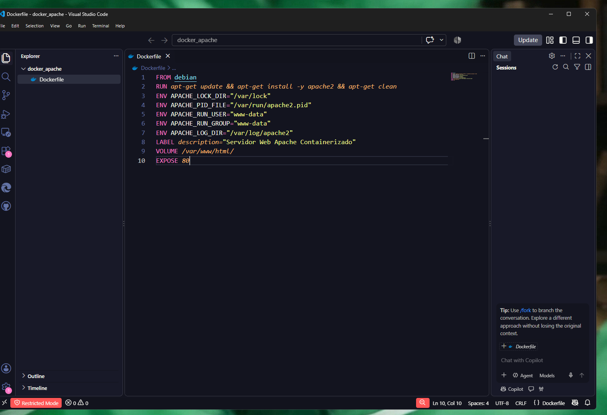
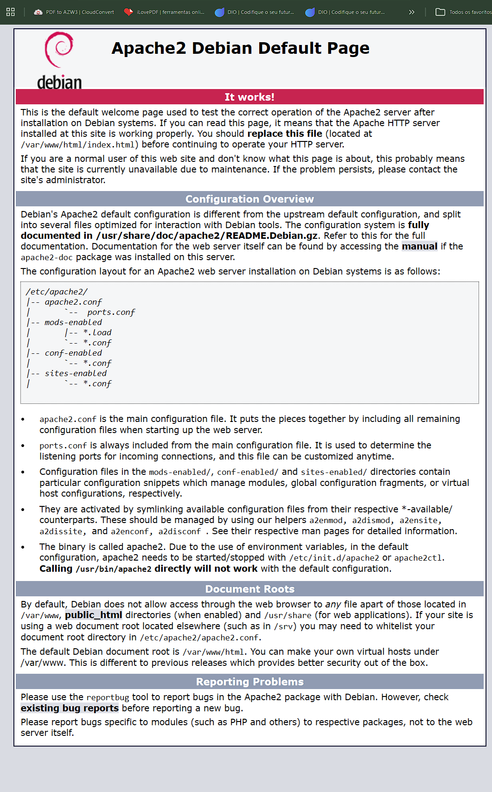
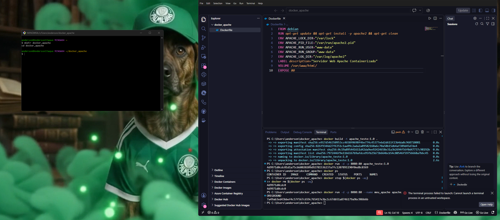
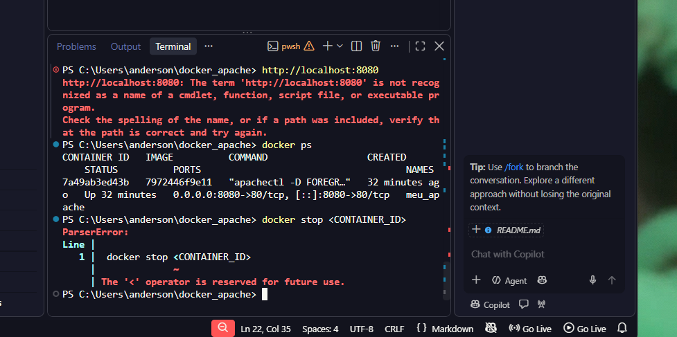
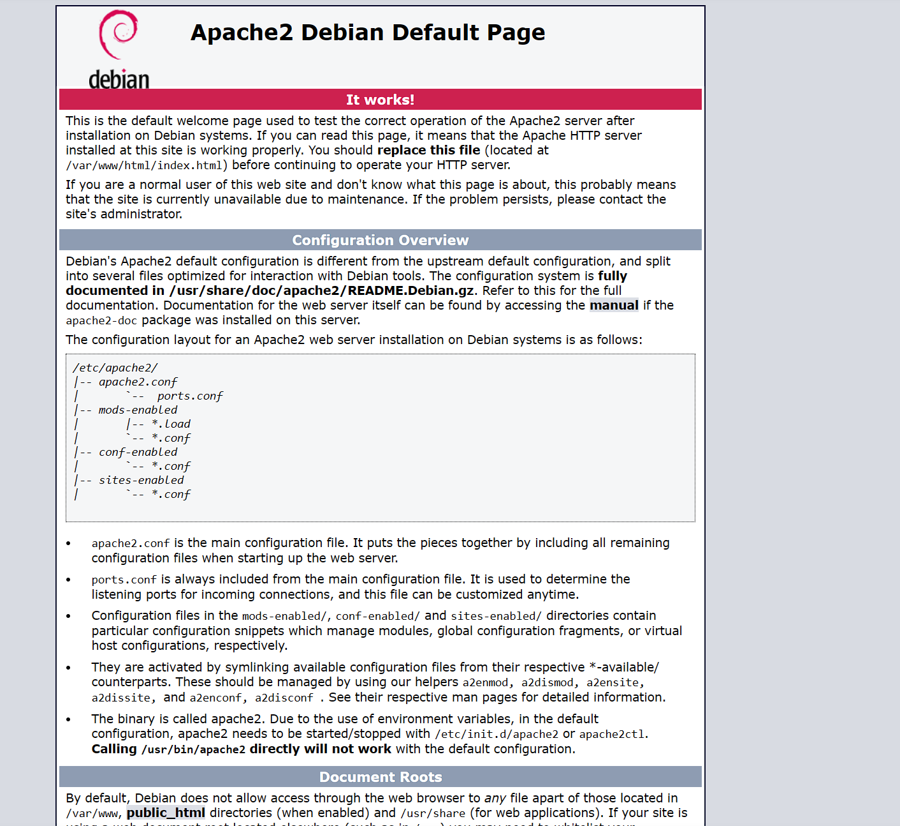
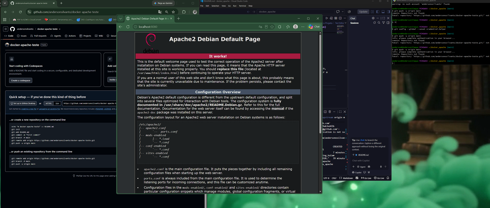
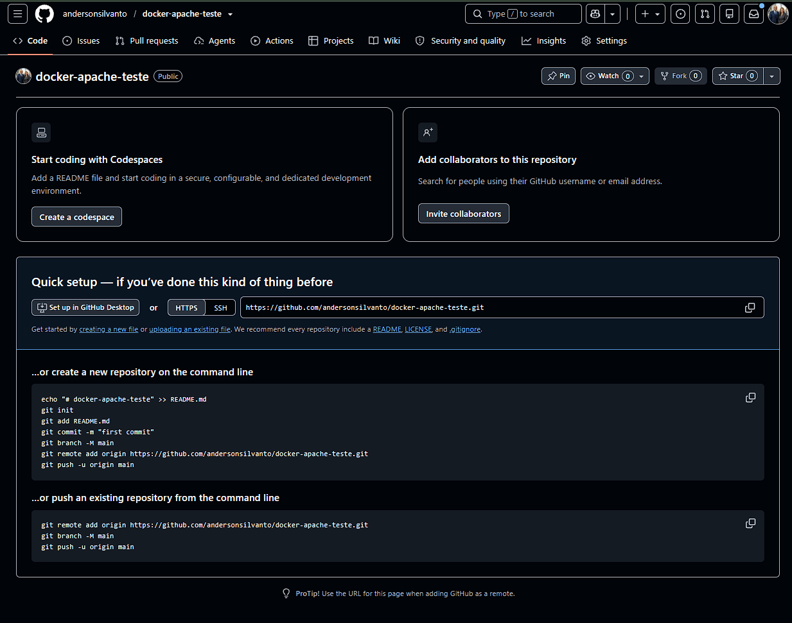
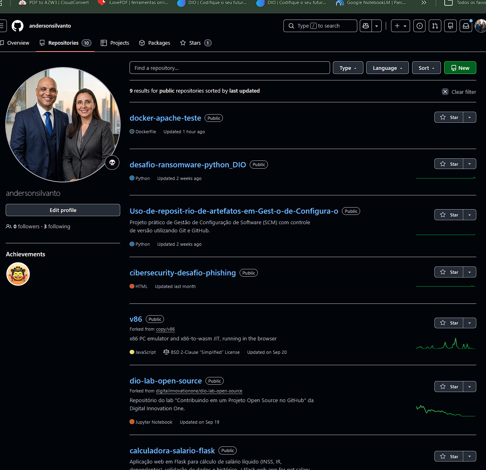

# Servidor Web Apache em Docker (Debian)

Este projeto contém a configuração de um ficheiro `Dockerfile` para construir e executar um servidor web **Apache** baseado na imagem oficial do **Debian**.

---

## 🛠️ Tecnologias Utilizadas

- **Docker / Docker Desktop**
- **Debian (Linux)**
- **Apache2 Web Server**
- **Git & GitHub**

---

## 🚀 Como Executar o Projeto

### 1. Construir a Imagem Docker

No terminal, dentro da pasta do projeto, execute o comando abaixo para construir a imagem:

22 | ```bash
23 | docker build -t apache_teste:1.0 .
24 | 
25 | ```
26 | 

RELATÓRIO DE AULA PRÁTICA: IMPLANTAÇÃO DE SERVIDOR WEB APACHE COM DOCKER
Curso: Engenharia de Software

Disciplina: Infraestrutura de Software / Containerização

Aluno: Anderson Lopes Vidal Silvanto

Data: Outubro de 2026

1. MÉTODOS
Nesta atividade prática, utilizou-se a tecnologia de containerização através da plataforma Docker Desktop para projetar, empacotar e implantar um servidor web Apache2 dentro de um ambiente isolado baseado na distribuição Linux Debian.

A metodologia adotada fundamenta-se nos princípios da Infraestrutura como Código e na arquitetura de microsserviços. Em vez de depender de configurações manuais e suscetíveis a falhas em um sistema operacional hospedeiro, todo o ambiente de execução, incluindo o sistema de arquivos base, as bibliotecas, as variáveis de ambiente e os parâmetros de rede e armazenamento, foi declarado de forma padronizada em um arquivo de instrução versionável chamado Dockerfile.

1.1 Arquitetura e Fundamentação Técnica
A solução foi construída tirando proveito dos mecanismos nativos do kernel Linux que o Docker orquestra:

Namespaces: Garantem o isolamento de processos, rede, montagens de arquivos e usuários, assegurando que o container opere de forma completamente independente do sistema hospedeiro.

Control Groups: Garantem a limitação e o controle de recursos de hardware, como uso de memória RAM e CPU, evitando que a aplicação monopolize a máquina hospedeira.

Camadas de Leitura e Escrita: A imagem é montada em camadas imutáveis e sobrepostas, tornando a construção leve, eficiente e reutilizável através do sistema de cache do Docker Engine.

1.2 Procedimentos e Passos Práticos
Estruturação do Ambiente Local: No sistema hospedeiro, criou-se o diretório de trabalho dedicado denominado docker_apache para armazenar o Dockerfile e centralizar o controle de versão do projeto.

Desenvolvimento do Dockerfile: Elaborou-se o arquivo declarativo Dockerfile definindo a receita precisa para a criação da imagem do servidor web. Cada instrução foi configurada com um propósito técnico específico:

A instrução FROM debian define a imagem base oficial do Debian.

A instrução RUN apt-get update && apt-get install -y apache2 && apt-get clean atualiza os repositórios, instala o Apache2 e limpa o cache.

A instrução ENV define as variáveis de ambiente necessárias para a inicialização e controle do daemon do Apache.

A instrução LABEL description="..." adiciona metadados descritivos para rastreamento e governança.

A instrução VOLUME /var/www/html/ declara um ponto de montagem persistente para o diretório raiz do Apache.

A instrução EXPOSE 80 documenta a porta de rede padrão HTTP.

Compilação da Imagem: Através do terminal, executou-se a compilação utilizando a flag -t para atribuir uma tag de versionamento: docker build -t apache_teste:1.0 .

Execução e Mapeamento de Portas: O container foi instanciado em modo desacoplado com mapeamento de porta: docker run -d -p 8080:80 apache_teste:1.0

Validação do Serviço e Teste de Conectividade: A validação funcional foi realizada acessando http://localhost:8080 no navegador.

Versionamento Avançado e Integração Contínua: Todo o projeto foi integrado ao Git e publicado no repositório remoto: github.com/andersonsilvanto/docker-apache-teste

2. RESULTADOS, VALIDAÇÃO DO CHECKLIST E AVALIAÇÃO
2.1 Cumprimento Integral do Checklist da Prática
[x] Instalar e configurar o Docker Desktop: Concluído com sucesso.

[x] Criar estrutura de diretórios e Dockerfile: Concluído com sucesso.

[x] Construir imagem com docker build: Concluído com sucesso (apache_teste:1.0).

[x] Executar container com docker run: Concluído com sucesso (porta 8080:80).

[x] Validar execução via navegador: Concluído com sucesso.

[x] Registrar resultados e publicação no GitHub: Concluído com excelência.

2.2 Respostas às Questões de Avaliação
Questão 1: Qual o benefício de usar containers nesse tipo de aplicação?
Portabilidade Absoluta: Encapsula a aplicação e dependências, garantindo que rode exatamente igual em qualquer ambiente.

Eficiência e Baixo Consumo: Compartilha o kernel do sistema hospedeiro, consumindo menos RAM e CPU que VMs tradicionais.

Isolamento de Aplicações: O servidor executa em ambiente seguro e isolado, prevenindo conflitos de portas ou bibliotecas.

Questão 2: Qual o papel das instruções do Dockerfile?
FROM: Define a imagem base do container.

RUN: Executa comandos de instalação e preparação durante a compilação.

ENV: Define variáveis de ambiente globais mantidas durante a execução.

LABEL: Adiciona metadados úteis para auditoria e governança.

VOLUME: Define pontos de armazenamento persistente.

EXPOSE: Sinaliza a porta de rede que o container utilizará.

## 3. 📷 GALERIA OPERACIONAL DO SISTEMA (EVIDÊNCIAS)

Abaixo estão registradas as visualizações operacionais extraídas diretamente do ambiente de execução:

| Estrutura do Dockerfile (VS Code) | Página Inicial do Servidor (Navegador) |
| :---: | :---: |
|  |  |

| Ambiente de Desenvolvimento e Terminal | Comandos e Validação no Terminal |
| :---: | :---: |
|  |  |

| Documentação e Detalhes da Página Apache | Visão Integrada do Ambiente de Trabalho |
| :---: | :---: |
|  |  |

| Repositório Público no GitHub | Perfil Geral no GitHub |
| :---: | :---: |
|  |  |

4. CONCLUSÃO
A realização desta atividade prática permitiu vivenciar como a tecnologia de containerização através do Docker transforma e simplifica o ciclo de vida do desenvolvimento e da implantação de infraestrutura de software. A transição de abordagens de implantação tradicionais para uma arquitetura baseada em containers traz ganhos expressivos em portabilidade, isolamento de ambientes, agilidade no movimento DevOps e escalabilidade horizontal.

REFERÊNCIAS BIBLIOGRÁFICAS
CANEL, R. Docker para Desenvolvedores. São Paulo: Novatec Editora, 2019.

FREEMAN, Emily. DevOps Para Leigos. São Paulo: Editora Alta Books, 2021.

GOUVEIA, F. Containers com Docker: Do desenvolvimento à produção. São Paulo: Casa do Código, 2020.

KIM, Gene; HUMBLE, Jez; DEBOIS, Patrick; WILLIS, John. Manual de DevOps. Rio de Janeiro: Editora Alta Books, 2018.

MIASAKI, M. Infraestrutura como Código e Containers: Práticas Modernas em DevOps. São Paulo: Novatec Editora, 2022.

MOULIN, L. Docker: Criando e Gerenciando Containers. São Paulo: Editora Érica, 2021.

WILDT, Daniel et al. Extreme programming: práticas para o dia a dia no desenvolvimento ágil de software. São Paulo, SP: Casa do Código, 2015.